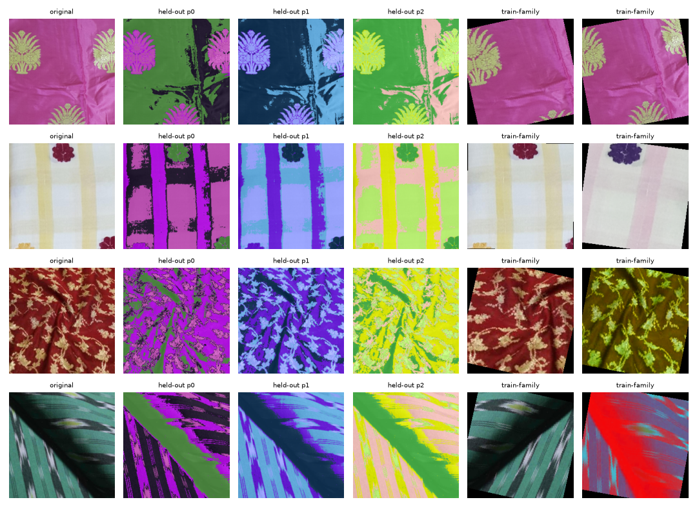
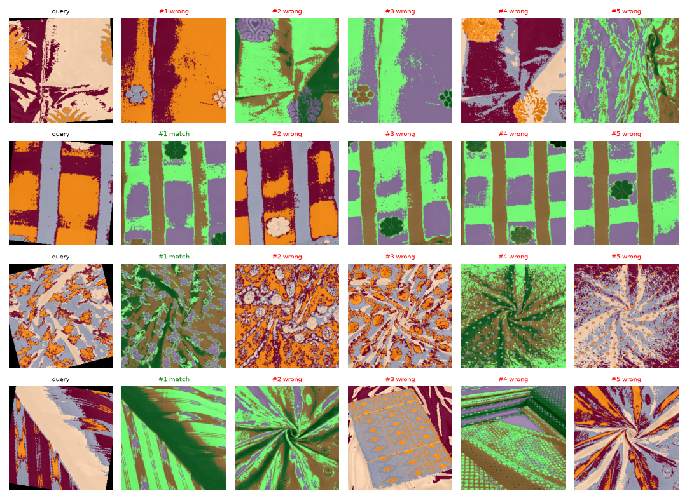

# Color-Invariant Saree Design Recognition

PyTorch system that embeds a saree image into a 128-d vector so the same design matches across colourways, and different designs in the same palette do not.

## Approach note

Pre: RGB->256->224; colour-free stem (gray, Sobel magnitude, local contrast) drops palette before learning. Model: ImageNet MobileNetV3-L (lean, 3.1M params) -> GeM -> 128-d L2 embedding. Train: each deduped image = a design; positives = synthetic colourways (hue rotate, channel permute/invert, curves, gradient maps) + crop/flip/rotate/blur; SupCon (t=0.1), 48 designs x 2 views, 50% of batches share one palette = same-palette hard negatives. Post: cosine ranking; threshold = val EER.

## Results (test split, 126 unseen designs)

| Model | ID held-out colourway Top-1 / Top-5 / mAP | ID palette-adversarial Top-1 / mAP | Same-palette confusion | Verif. AUC | EER | TAR@FAR1% | Acc |
|---|---|---|---|---|---|---|---|
| ImageNet MobileNetV3, RGB (baseline) | 0.431 / 0.640 / 0.538 | 0.193 / 0.311 | 0.775 | 0.827 | 0.234 | 0.147 | 0.780 |
| ImageNet MobileNetV3 + structure stem, untrained | 0.347 / 0.532 / 0.442 | 0.410 / 0.519 | 0.344 | 0.718 | 0.341 | 0.163 | 0.677 |
| **SareeNet (ours)** | **0.667 / 0.831 / 0.749** | **0.791 / 0.864** | **0.116** | **0.970** | **0.079** | **0.750** | **0.907** |

On training-family colourways the trained model reaches 0.894 Top-1. It correctly rejects 88.9% of same-palette negative pairs. Full numbers are in `results/metrics.json` and `results/metrics.md`.




## Data

- Kaggle Indian Saree Patterns: 1468 images. This is a Roboflow export with 3 noisy copies of every source, and the same source also appears in train, valid and test.
- DeepLure Drive corpus: 165 images, all unlabelled.
- Cleaning: drop images with min side < 96 px and resize to 256x256. Near-duplicates are merged with a 64-bit dHash (Hamming distance <= 4, inverted hash also checked), giving 589 unique designs from 1633 images. Each group is one design id, and its members count as real positives.
- Split by design, using an md5 hash of the design key: train 405 / val 58 / test 126 designs. No design crosses splits, and the original Kaggle split is ignored because it leaks.
- None of the data has design or colourway labels, so a design is defined as one deduplicated image group, and colourways are generated synthetically.

## Evaluation protocol

All evaluation uses unseen designs. The test colourways come from a different recolouring method than training: k-means (k=4) segments the yarn colours, and each segment is swapped to a random new palette while keeping its shading. Queries also get a random crop (50-100%), a flip and a rotation of up to 15 degrees.

1. **Identification, held-out colourway**: the gallery is every original test image. Queries are each design in 3 new palettes. Metrics: Top-1, Top-5, mAP.
2. **Identification, palette-adversarial**: the gallery is every design in palette A plus every design in palette B. The query is a design in palette B, with its own palette-B copy removed. The only correct answer is in a different palette, and every distractor shares the query's palette. Results are averaged over 3 palette pairs. "Same-palette confusion" is the share of queries whose top-1 result is a wrong design in the query's palette.
3. **Verification**: 252 positive pairs (same design, different palettes or original vs recoloured), 126 same-palette negatives and 126 different-palette negatives. Metrics: ROC-AUC, EER, TAR@FAR=1%, plus accuracy at the threshold fixed on val.
4. The checkpoint is chosen on the val split only (best epoch 20 of 60). The test split is used once.

## Efficiency (`results/efficiency.json`)

| Params | FLOPs (224x224) | Embedding | Latency |
|---|---|---|---|
| 3.09M (backbone 2.97M, head 0.12M) | 0.435 GFLOPs (0.218 GMACs) | 128-d, 512 B fp32 / 256 B fp16 | 41 ms CPU (8 threads), 16 ms GPU fp16 (RTX 2050), 695 img/s GPU batch 64 |

The stem has fixed weights and is almost free, because colour invariance comes from the input rather than from a larger network. Training takes about 18 minutes on a 4 GB laptop GPU.

## How to run

```bash
pip install -r requirements.txt
gdown --folder https://drive.google.com/drive/folders/1V_DcXJ50QYV9nEqvq7fqKno_lhbSPdBM -O data/deeplure
python prepare_data.py
python train.py --epochs 60
python evaluate.py
python efficiency.py
python infer.py identify --query path/to/query.jpg --gallery path/to/gallery_folder --topk 5
python infer.py verify --a img1.jpg --b img2.jpg
```

`prepare_data.py` downloads the Kaggle set through `kagglehub`. If `data/deeplure` is missing, it runs on Kaggle data only. The same scripts run as-is in a Kaggle Notebook with a GPU.

## Files

- `saree/colorway.py`: training colourway augmentations and the held-out k-means palette swap
- `saree/data.py`: loading, dHash deduplication, design split, augmentations
- `saree/model.py`: structure stem, MobileNetV3 + GeM + embedding head, SupCon loss
- `saree/bench.py`: evaluation protocol and metrics
- `train.py`, `evaluate.py`, `efficiency.py`, `infer.py`, `prepare_data.py`
- `checkpoints/sareenet.pt`: trained model, including the verification threshold

## Disclosures and limitations

- Pretrained weights: torchvision MobileNetV3-Large `IMAGENET1K_V2`. No other external data.
- The colourways are synthetic because the data has no real colourway pairs. Real dyeing and weaving changes (texture, lighting) may be harder.
- Some different photos of near-identical designs were not merged by dHash, so they count as wrong matches. The reported numbers are therefore slightly pessimistic.
- The val set is small (58 designs), so model selection is noisy.
- The Drive corpus is not redistributed (`data/` is git-ignored) and should be deleted after the exercise.
